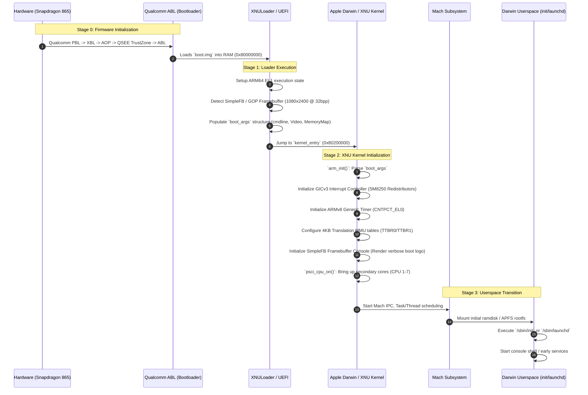

# Boot Flow Specification for iospro-r8q

## Detailed Execution Sequence



---

## 1. Boot Arguments (`boot_args`)
XNU requires a populated `boot_args` structure passed in register `x0` at kernel entry.

```c
struct boot_args {
    uint16_t    version;            /* BootArgsVersion = 2 */
    uint16_t    efiMode;            /* 32/64 bit */
    uint32_t    flags;              /* Boot flags */
    uint64_t    topOfKernelData;    /* End of kernel physical data */
    PE_Video    video;              /* Framebuffer configuration */
    uint32_t    machineType;        /* Machine identifier */
    uint64_t    deviceTreeP;        /* Physical address of flattened DeviceTree */
    uint32_t    deviceTreeLength;   /* Size of DeviceTree */
    char        CommandLine[1024];  /* Kernel command line */
    uint64_t    boot_args_phys;     /* Physical address of this structure */
};
```

### Video Configuration (`PE_Video`)
For the Samsung Galaxy S20 FE 5G:
- `v_baseAddr`: Framebuffer physical address (configured by ABL or SimpleFB node in DTB, e.g. `0x9c000000`)
- `v_width`: 1080
- `v_height`: 2400
- `v_depth`: 32 (ARGB8888)
- `v_rowBytes`: 1080 * 4 = 4320

### Kernel Command Line Options
```text
console=simplefb -v debug=0x14e cs_enforcement=0 amfid=0 serial=0
```
- `-v`: Verbose boot log output to video console.
- `debug=0x14e`: Enables kernel debugger, keeps panics on screen, disables watchdog reboots.
- `cs_enforcement=0`: Disables Apple code signing verification requirement on Mach-O binaries.
- `amfid=0`: Disables AppleMobileFileIntegrity checks.
